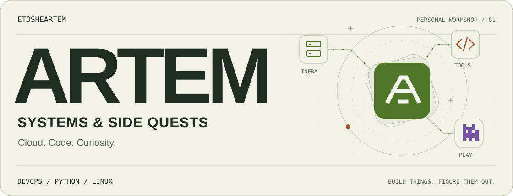
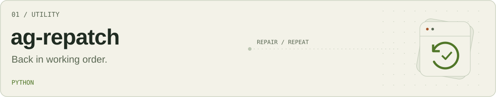
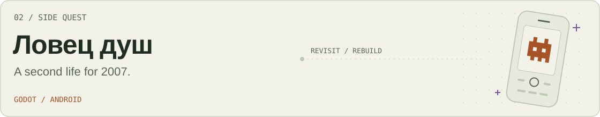

<picture>
  <source media="(prefers-color-scheme: dark) and (max-width: 600px)" srcset="assets/header-dark-mobile.svg">
  <source media="(max-width: 600px)" srcset="assets/header-light-mobile.svg">
  <source media="(prefers-color-scheme: dark)" srcset="assets/header-dark.svg">
  
</picture>

### Привет, я Артём.

Занимаюсь облачной инфраструктурой, пишу на Python и обживаю Linux. Люблю разбираться, как всё устроено: от Kubernetes и домашней лаборатории до внутренностей приложений и игр с кнопочных телефонов.

**Автоматизировать рутину. Починить неудобное. Вернуть к жизни интересное.**

 

### Из моей мастерской

<a href="https://github.com/etosheartem/ag-repatch">
  <picture>
    <source media="(prefers-color-scheme: dark) and (max-width: 600px)" srcset="assets/project-patch-dark.svg">
    <source media="(max-width: 600px)" srcset="assets/project-patch-light.svg">
    <source media="(prefers-color-scheme: dark)" srcset="assets/project-patch-dark-wide.svg">
    
  </picture>
</a>

**[ag-repatch](https://github.com/etosheartem/ag-repatch)** восстанавливает локальный патч Antigravity после обновлений: находит установку, сохраняет оригиналы и применяет патч заново.

`Python` · Windows / macOS / Linux · **[Скачать →](https://github.com/etosheartem/ag-repatch/releases)**

 

<a href="https://github.com/etosheartem/lovec-dush">
  <picture>
    <source media="(prefers-color-scheme: dark) and (max-width: 600px)" srcset="assets/project-game-dark.svg">
    <source media="(max-width: 600px)" srcset="assets/project-game-light.svg">
    <source media="(prefers-color-scheme: dark)" srcset="assets/project-game-dark-wide.svg">
    
  </picture>
</a>

**[Ловец душ](https://github.com/etosheartem/lovec-dush)** — фанатский ремейк квеста с кнопочного телефона для Android. Тот же сюжет и загадки; новая графика, звук и управление.

`Godot` · GDScript / Android · **[Скачать →](https://github.com/etosheartem/lovec-dush/releases)**

 

### Под рукой

**Инфраструктура** &nbsp; `Linux` `Kubernetes` `Docker` `Helm` `GitHub Actions` 
**Код и данные** &nbsp; `Python` `Go` `Bash` `PostgreSQL` `Redis` 
**Домашняя лаборатория** &nbsp; `Arch` `KVM / QEMU` `MikroTik` `WireGuard`

А ещё — AI-агенты, реверс-инжиниринг и идеи, ради которых хочется открыть редактор вечером.

---

**Есть о чём поговорить?** [Telegram ↗](https://t.me/etosheartem)

etosheartem / systems &amp; side quests
