<picture>
  <source media="(prefers-color-scheme: dark) and (max-width: 600px)" srcset="assets/cluster-dark-mobile.svg">
  <source media="(max-width: 600px)" srcset="assets/cluster-light-mobile.svg">
  <source media="(prefers-color-scheme: dark)" srcset="assets/cluster-dark.svg">
  
</picture>

## Артём. Kubernetes, Linux, автоматизация.

Cloud & DevOps Engineer. **Kubernetes — мой основной фокус**: инфраструктура, контейнеры, Helm и всё, что связывает их в работающую систему. Пишу на Python и Go, автоматизирую повторяющиеся операции и делаю внутренние инструменты.

Разбираюсь в проблемах по слоям: приложение → контейнер → Linux → сеть. Нравится понимать, что происходит между `kubectl apply` и работающим сервисом.

### Ниже по стеку

| Слой | Инструменты |
| :--- | :--- |
| **Кластер и контейнеры** | **Kubernetes** · Helm · Docker |
| **Автоматизация** | Python · Go · Bash · GitHub Actions |
| **Системы и сеть** | Linux · KVM/QEMU · MikroTik · WireGuard |
| **Данные** | PostgreSQL · Redis |

Домашняя лаборатория и другие интересы

Arch Linux, виртуальные машины, сети и автоматизация. Ещё — AI-агенты, Telegram-боты и реверс-инжиниринг. Часть идей остаётся экспериментами, часть становится отдельными проектами.

### Вне кластера

**[ag-repatch ↗](https://github.com/etosheartem/ag-repatch)** — Python-инструмент, который восстанавливает локальный патч Antigravity после обновлений. Windows, macOS и Linux. [Релизы](https://github.com/etosheartem/ag-repatch/releases).

**[Ловец душ ↗](https://github.com/etosheartem/lovec-dush)** — фанатский ремейк J2ME-квеста 2007 года на Godot для Android. Разобрал оригинал и перенёс сюжет и загадки, добавив новую графику и звук. [Скачать](https://github.com/etosheartem/lovec-dush/releases).

---

<a href="https://t.me/etosheartem"><strong>Telegram / @etosheartem ↗</strong></a>
