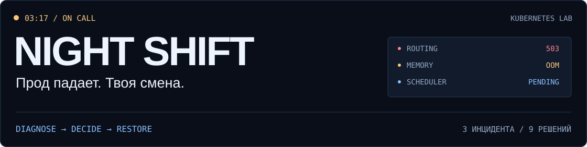

<!-- Generated by scripts/build_readme.py. Edit app/incidents.json for the game. -->
<picture><source media="(max-width: 600px)" srcset="assets/night-shift-mobile.svg"></picture>

**Прими смену.** Выбери учебный инцидент → открой вывод команд → найди рабочее исправление.

<table width="100%"><tr><td>

<picture><source media="(max-width: 600px)" srcset="assets/case-01-mobile.svg"></picture>

После релиза внешний запрос получает 503 от ingress. Оба пода api готовы к работе. Дежурный в чате предлагает «просто рестартнуть». Сначала собери факты.

<strong>1 / Исследуй</strong> — нажимай на команды, чтобы увидеть вывод.

<kbd>1</kbd> <strong>Проверить поды и labels</strong>

<pre><code>$ kubectl -n arcade get pods --show-labels</code></pre>

<pre><code>NAME    READY  STATUS   LABELS
api-a   1/1    Running  app=api-v2
api-b   1/1    Running  app=api-v2</code></pre>

Оба контейнера готовы. Обрати внимание на labels.

<kbd>2</kbd> <strong>Посмотреть конфигурацию Service</strong>

<pre><code>$ kubectl -n arcade get svc api -o yaml</code></pre>

<pre><code># значимый фрагмент
spec:
  selector:
    app: api-v1
  ports:
    - port: 80
      targetPort: 8080</code></pre>

Приложение слушает 8080; порт совпадает.

<kbd>3</kbd> <strong>Проверить EndpointSlice</strong>

<pre><code>$ kubectl -n arcade get endpointslice api-x -o yaml</code></pre>

<pre><code># значимый фрагмент
metadata:
  labels:
    kubernetes.io/service-name: api
endpoints: []</code></pre>

У Service нет backend-адресов.

<strong>2 / Прими решение</strong> — выбери действие и посмотри, что изменится.

<kbd>A</kbd> <strong>Перезапустить Deployment</strong>

<picture></picture>

<pre><code>rollout: complete
pods: 2/2 Ready
service endpoints: 0
external request: HTTP 503</code></pre>

Новые поды получили прежние labels. Перезапуск не изменил selector Service — выбирать по-прежнему некого.

<em>Попробуй другое действие или вернись к диагностике.</em>

<kbd>B</kbd> <strong>Исправить selector Service</strong>

<picture></picture>

<pre><code>selector: app=api-v2
ready endpoints: 2
external request: HTTP 200</code></pre>

Selector api-v1 не совпадал с labels api-v2. Исправление в манифесте Service или Helm values возвращает маршрутизацию и сохраняется при следующих релизах.

<strong>Running и Ready — ещё не проверка пути от клиента до приложения.</strong>

<a href="https://kubernetes.io/docs/tasks/debug/debug-application/debug-service/">Разобрать механизм в документации Kubernetes ↗</a>

<kbd>C</kbd> <strong>Увеличить число реплик до пяти</strong>

<picture></picture>

<pre><code>pods: 5/5 Ready
service endpoints: 0
external request: HTTP 503</code></pre>

Теперь в кластере больше здоровых подов, до которых не доходят запросы. Масштабирование не исправляет несовпадение labels.

<em>Попробуй другое действие или вернись к диагностике.</em>

<picture><source media="(max-width: 600px)" srcset="assets/case-02-mobile.svg"></picture>

Worker стартует, загружает справочник и пропадает. Перезапуски повторяются. На узле есть свободная память; новая версия справочника стала больше.

<strong>1 / Исследуй</strong> — нажимай на команды, чтобы увидеть вывод.

<kbd>1</kbd> <strong>Узнать причину завершения</strong>

<pre><code>$ kubectl -n arcade describe pod worker-a</code></pre>

<pre><code># значимый фрагмент
State:          Waiting
  Reason:       CrashLoopBackOff
Last State:     Terminated
  Reason:       OOMKilled
  Exit Code:    137
Restart Count:  7</code></pre>

CrashLoopBackOff описывает повторные падения. Причину ищи в Last State.

<kbd>2</kbd> <strong>Прочитать предыдущие логи</strong>

<pre><code>$ kubectl -n arcade logs worker-a --previous</code></pre>

<pre><code>[boot] worker starting
[cache] loading reference dataset
[cache] allocating 96 MiB
&lt;process terminated&gt;</code></pre>

Нужны логи предыдущего контейнера, а не только нового запуска.

<kbd>3</kbd> <strong>Сверить лимиты и замеры</strong>

<pre><code>$ kubectl -n arcade get deploy worker -o yaml</code></pre>

<pre><code># resources контейнера worker
requests:
  memory: 64Mi
limits:
  memory: 64Mi</code></pre>

В учебном нагрузочном отчёте этой сборки: обычное потребление 120–140 MiB, пик 148 MiB, последующего роста нет. Узел позволяет выделить 256 MiB.

<strong>2 / Прими решение</strong> — выбери действие и посмотри, что изменится.

<kbd>A</kbd> <strong>Отключить liveness probe</strong>

<picture></picture>

<pre><code>liveness probe: disabled
last termination: OOMKilled
restart count: 8</code></pre>

Контейнер завершился из-за памяти. Отключение probe не отменяет memory limit.

<em>Попробуй другое действие или вернись к диагностике.</em>

<kbd>B</kbd> <strong>Добавить ещё две реплики</strong>

<picture></picture>

<pre><code>worker-a: OOMKilled
worker-b: OOMKilled
worker-c: OOMKilled</code></pre>

Каждая реплика загружает тот же справочник в свой контейнер с тем же лимитом 64 MiB.

<em>Попробуй другое действие или вернись к диагностике.</em>

<kbd>C</kbd> <strong>Выделить память по результатам замеров</strong>

<picture></picture>

<pre><code>requests.memory: 160Mi
limits.memory:   256Mi
rollout: complete
worker: Ready
observed RSS: 136Mi</code></pre>

Запрос покрывает измеренное потребление, лимит оставляет запас. После обновления шаблона Deployment и rollout нужно повторить нагрузочную проверку. Если потребление продолжит расти, отдельно искать утечку.

<strong>Повторный запуск не увеличивает cgroup memory limit.</strong>

<a href="https://kubernetes.io/docs/concepts/configuration/manage-resources-containers/">Разобрать механизм в документации Kubernetes ↗</a>

<picture><source media="(max-width: 600px)" srcset="assets/case-03-mobile.svg"></picture>

Deployment увеличили с двух реплик до трёх. Новая реплика висит в Pending. На графике CPU меньше 20% — почему scheduler отказывается её разместить?

<strong>1 / Исследуй</strong> — нажимай на команды, чтобы увидеть вывод.

<kbd>1</kbd> <strong>Прочитать событие scheduler</strong>

<pre><code>$ kubectl -n arcade describe pod api-c</code></pre>

<pre><code># значимый фрагмент
Status: Pending
Node:   &lt;none&gt;
Reason: FailedScheduling
0/2 nodes are available:
  2 Insufficient cpu.
Container CPU request: 500m</code></pre>

Не хватает CPU по правилам размещения. Других ограничений в этом стенде нет.

<kbd>2</kbd> <strong>Проверить текущую загрузку</strong>

<pre><code>$ kubectl top nodes</code></pre>

<pre><code>NAME      CPU(cores)  CPU%
worker-a  320m        16%
worker-b  360m        18%</code></pre>

Это фактическое использование CPU в момент измерения.

<kbd>3</kbd> <strong>Проверить allocatable и requests</strong>

<pre><code>$ kubectl describe nodes worker-a worker-b</code></pre>

<pre><code># сокращённая сводка по двум узлам
worker-a:
  allocatable.cpu: 2000m
  allocated CPU requests: 1800m
worker-b:
  allocatable.cpu: 2000m
  allocated CPU requests: 1800m</code></pre>

На каждом узле остаётся 200m незарезервированного CPU. Новому поду нужно 500m на одном узле.

<strong>2 / Прими решение</strong> — выбери действие и посмотри, что изменится.

<kbd>A</kbd> <strong>Перезапустить scheduler</strong>

<picture></picture>

<pre><code>scheduler: available
api-c: Pending
reason: Insufficient cpu</code></pre>

Scheduler работает правильно. После перезапуска он видит те же requests и тот же объём allocatable CPU.

<em>Попробуй другое действие или вернись к диагностике.</em>

<kbd>B</kbd> <strong>Добавить ёмкость в node pool</strong>

<picture></picture>

<pre><code>worker-c: Ready
allocatable.cpu: 2000m
api-c scheduled on worker-c
deployment api: 3/3 Ready</code></pre>

На новом узле есть место для CPU request 500m. Scheduler размещает под по requests и allocatable, а не по моментальному графику использования CPU.

<strong>Низкая утилизация и свободная ёмкость для requests — разные величины.</strong>

<a href="https://kubernetes.io/docs/concepts/configuration/manage-resources-containers/">Разобрать механизм в документации Kubernetes ↗</a>

<kbd>C</kbd> <strong>Добавить toleration</strong>

<picture></picture>

<pre><code>toleration: added
api-c: Pending
reason: Insufficient cpu</code></pre>

Toleration помогает с taints, но не добавляет ресурсы. Событие scheduler указывало на CPU, а не на taint.

<em>Попробуй другое действие или вернись к диагностике.</em>

</td></tr></table>

Выбор другого инцидента переключает панель. Можно исследовать и пробовать решения в любом порядке.

---

**Kubernetes · Linux · Python · Go**

Кто собрал этот стенд

Cloud & DevOps Engineer. Занимаюсь Kubernetes, инфраструктурой и автоматизацией. В работе — Helm, Docker, GitHub Actions, Python и Go. В домашней лаборатории — Arch, KVM/QEMU, MikroTik и WireGuard. Ещё интересуюсь AI-агентами и реверс-инжинирингом.

[ag-repatch](https://github.com/etosheartem/ag-repatch) — восстановление патча Antigravity · [Ловец душ](https://github.com/etosheartem/lovec-dush) — ремейк J2ME-квеста

**[Telegram ↗](https://t.me/etosheartem)**
